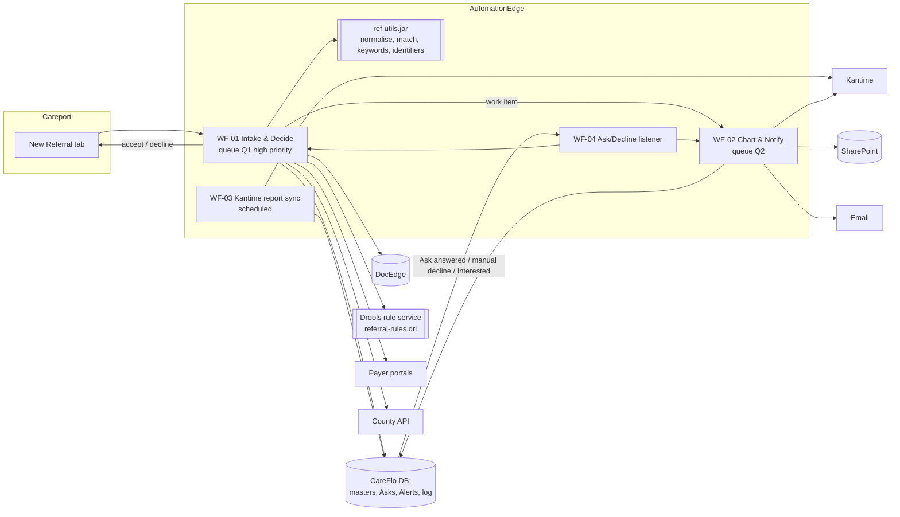
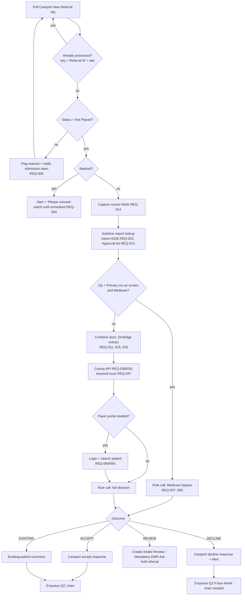

# Solution Design Document
## Ohioans HomeHealth Care: Referral Bot (Careport) migration to the new CareFlo platform

| | |
|---|---|
| Version | 0.1 draft, 2026-11-23 |
| Based on | BRD v1.25; masters dated 2026-11-23; `02-requirements.json` r2; `03-gap-register.md` r2; `04-tech-decision.md` |
| Status | Draft for review. Not approved. Seven critical gaps are open (section 15). |

**Labels.** Requirement IDs (`REQ-nnn`) point to `02-requirements.json`. **[DD-n]** marks a design decision made in this document; it isn't in the BRD and needs approval. **[OPEN]** marks something not decided; see section 15.

---

## 1. Executive summary

The bot watches Careport for new home-health referrals and pulls the referral data from the screen and from the PDFs. It checks whether the patient is already known in Kantime, then decides to accept, decline or send the referral for intake review, using the agency's rules for service area, age and plan, exception keywords, payer, capacity and restricted facilities. It answers the referral in Careport and creates or updates the patient chart in Kantime. Every action is logged in CareFlo.

Speed is the main business driver. Portals are first-come first-served, and referrals must be answered within 1 hour (REQ-102). The design therefore:
- makes the accept/decline decision quickly, in one rule-engine call;
- does the slower Kantime chart work in a separate queue [DD-1].

The decision logic lives in a Drools rule set, separate from the UI bots, because the rules have changed in 25 BRD versions (04-tech-decision §3).

## 2. Background and scope

**Background.** Ohioans HHC already runs an AutomationEdge referral bot. This project moves it to the new CareFlo platform. In the new platform, masters, Asks and Alerts are managed in CareFlo, and the rules follow the approved To-Be flow. That flow diagram has not been received yet: [OPEN-5].

**In scope**
- **Careport:** login, monitoring, masked and status handling, data capture, document handling and responses (REQ-001-006, 014-020).
- **Medicare bypass and the full eligibility path:** REQ-007-013 and REQ-030-063.
- **Kantime:** report lookup and the existing-patient flows (REQ-021-029); new chart, readmit, non-admit, eligibility fields, team and marketer (REQ-058, 071-090).
- **Payer portal login, patient search and outcome routing:** REQ-064, 065, 067-069.
- **Identifier-based payer identification:** REQ-092-098.
- **CareFlo:** Asks, Alerts, manual decline, the "Interested" action and logging (REQ-070, 091, 099, 101).
- **Master data handling:** REQ-107-112.

**Out of scope**
- **Per-portal eligibility steps and Commercial eligibility notes** (REQ-066, 086): deferred, because the Payer Portal BRD isn't available.
- **Referral portals other than Careport** (REQ-105, ASM-013).
- **Coordination team work** (REQ-106).

## 3. Functional requirements

The full list is in `02-requirements.json` (112 requirements, 108 in scope). This table groups them by design module.

| Module | Requirement IDs | Status notes |
|---|---|---|
| M1 Authentication | REQ-001, 064, 104 | OTP handling [OPEN-9] |
| M2 Referral discovery | REQ-002-006 | Duplicate key [DD-2] |
| M3 Extraction | REQ-011, 014-017 | DocEdge confidence threshold [OPEN-10] |
| M4 Documents | REQ-018-020, 084 | |
| M5 Kantime lookup | REQ-013, 021-023 | Approval Required List resolved in r2 |
| M6 Decision (rule engine) | REQ-007-010, 012, 029-057, 059-063, 067-070, 092-096, 109 | Blocked data: REQ-008, 041-044, 048-055, 062-063 [OPEN-1..4] |
| M7 Portal response | REQ-004, 006, 024-028, 032-034, 041-044, 048, 052-053, 056, 060, 067, 069, 092, 099 | Response vocabulary [OPEN-11] |
| M8 Existing-patient actions | REQ-024-028 | |
| M9 Kantime chart | REQ-058, 071-085, 087 | Blocked: REQ-081 (routing data) |
| M10 Team and notifications | REQ-088-090 | Blocked [OPEN-3] |
| M11 CareFlo integration | REQ-070, 091, 097, 099, 101 | Ask/Alert catalogue [OPEN-12] |
| M12 Master data | REQ-046, 061, 107-112 | |
| NFR | REQ-102-104 | |

## 4. Existing system architecture

| Component | Today | Source |
|---|---|---|
| Referral portal | Careport (Chrome web app, public URL, password reset, no UAT) | REQ-104 |
| EMR | Kantime (Chrome web app, UAT available) | REQ-104 |
| Payer portals | Ability, UHC, Availity, Priority Health, Ohio Medicaid, Golden Rule, UMR, Mi MCD; Cigna is referenced in 5.25 | REQ-064, CON-007 |
| RPA layer | The existing AutomationEdge referral bot. Its workflows weren't supplied, so they can't be assessed for reuse. | 04 §4 |
| Masters | Previously a Google sheet; now CareFlo masters: Approval Required List, Exception Keywords, Facility, Payor Mapping, Restricted Facility. **The Service Area master is missing.** | r2 |
| CareFlo app | Asks, Alerts, manual decline, the "Interested" action, status log | REQ-070, 091, 099, 101 |
| Rule engine | **Unknown** whether CareFlo hosts a Drools runtime [OPEN-7] | 04 §6 |
| Unified schema | None supplied. Section 8 proposes one [DD-3]. | |

## 5. Proposed architecture and technology stack



| Layer | Technology | Rationale (from 04-tech-decision) |
|---|---|---|
| Orchestration, queues, CareFlo, email, SharePoint | AutomationEdge Process Studio | Native to the AE and CareFlo ecosystem |
| Careport, Kantime and payer-portal UI | Process Studio web steps (Chrome) | Proven stack. A 2-day Careport spike checks stability; if it fails, use Playwright (the runner-up). |
| Decisions | Drools DRL | Rules change often and are table-shaped; can be unit-tested |
| Matching and normalisation | Java JAR (`ref-utils`) [DD-4] | Fiddly string logic, with unit tests |
| PDF extraction | DocEdge | Named in the BRD (REQ-011) |

**Must be verified, not assumed:** whether the AE web activities can run headless, and whether they can run in Linux or containers. Until confirmed, plan for interactive Windows agents with Chrome.

**Runners [DD-1]:**
- 2 agents minimum: Q1 (decide and respond) and Q2 (chart and notify).
- WF-03 runs on Q2's agent between items.

## 6. Workflow design

### 6.1 Main sequence (WF-01 Intake & Decide)



**Note on the Medicare bypass.** The Kantime lookup (step F) runs **before** the bypass check, so an existing patient always goes down the existing-patient path. This is design decision [DD-5], made to close GAP-02 / CON-012. It adds only a local file lookup. **Business approval required [OPEN-6].**

The rule engine makes two calls with the same contract (section 8): a "bypass" call, using screen data only, and a "full" call.

### 6.2 Modules

| Module | Workflow / component | Key steps | Requirements |
|---|---|---|---|
| M1 Authentication | Shared sub-workflow `SW-Login` | Read credentials from the vault; log in; read the OTP from the bot mailbox [OPEN-9]; reuse the session; re-login on expiry | REQ-001, 064, 104 |
| M2 Discovery | WF-01 | Poll every 60 seconds [DD-6]; dedupe on Referral ID + site in the CareFlo log [DD-2]; handle Not Placed and masked referrals | REQ-002-006 |
| M3 Extraction | WF-01 + DocEdge | Screen fields 1-25; PDF types H&P, CRF, F2F, Continuation of Care, DC Order, AVS, Referral; services/orders; discharge note and SOC date | REQ-011, 014-017 |
| M4 Documents | WF-01 (combine) / WF-02 (upload) | Combine, poll for completion, SharePoint name `<First Last> Intake <MMDDYY>`; per-document Kantime names per 5.3 | REQ-018-020, 084 |
| M5 Kantime lookup | WF-03 (sync) + JAR | Download RM-Intake list (7am/12pm/5pm/10pm EST) and Client Intake list (every 30 minutes) into CareFlo tables; match normalised name + DOB; both lists found → RM-Intake wins | REQ-021-023 |
| M6 Decision | Drools service | Section 9 | see section 3 |
| M7 Response | WF-01 | Careport response, reason and comment per outcome code; repeat for every site on multi-branch requests | REQ-006 and the outcome table in §9 |
| M8 Existing patient | WF-02 | Intake/Conditional, Active/Recert/EOE, Transfer/On Hold, PSOC uploads and emails; Careport vs Kantime mismatch list | REQ-024-028 |
| M9 Kantime chart | WF-02 sub-workflows `SW-NewChart`, `SW-Readmit`, `SW-NonAdmit`, `SW-Eligibility` | Section 7.2 | REQ-058, 071-087 |
| M10 Team and notifications | WF-02 | CC1, marketer (skip "HOUSE"), Admission DL, dummy facility → Team 2 | REQ-088-090 |
| M11 CareFlo | WF-04 | Listen for Ask answers, manual declines and "Interested"; resume the referral | REQ-070, 091, 095, 099 |
| M12 Master data | WF-03 + JAR | Load and validate masters (blank required columns, duplicates, future DOB, "NULL"); alert Intake on failure | REQ-107-112 |

## 7. Data mapping

### 7.1 Careport → unified referral record [DD-3]

| # | Careport source | Unified field | Transformation | When null |
|---|---|---|---|---|
| 1 | Patient information > First, Last name | `patient.firstName`, `patient.lastName` | Trim; keep the original; `nameKey` = uppercase, letters only (JAR) | Basic Info Missing Ask (REQ-012) |
| 2 | Date of Birth | `patient.dob` | Parse MM/DD/YYYY to an ISO date; `age` = completed years on the processing date (REQ-045) | Basic Info Missing Ask |
| 3 | Sex at Birth | `patient.sex` | As shown | Mandatory EMR Ask at chart time |
| 4 | Admission Information or Referral Information > Sending Organization / Facility | `referral.facility` | Normalise (REQ-107) | Treat as a physician referral |
| 5, 7 | Financial > Primary Plan Description / Plan Number | `payer.primary.planDescription`, `payer.primary.policyId` | Trim and uppercase for matching | Take from PDF; if still missing, Mandatory EMR Ask (REQ-030) |
| 6 | SSN | `patient.ssn` | **Masked in all logs** (§12) | Optional |
| 8-10 | Address / County / Zip | `patient.address{line,city,state,zip,county}`, `patient.isPoBox` | PO Box regex [DD-7]; county from the API if not on screen | Medicare: Ask (REQ-031); non-Medicare: Ask (REQ-036); county null → zip only (REQ-039) |
| 11 | Primary care Physician | `referral.pcp` | | Leave Referring Physician blank (REQ-081) |
| 12-14 | Race, Marital status, Religion (PDF) | `patient.race`, `patient.maritalStatus`, `patient.religion` | Map to the Kantime list; skip Religion if no match (REQ-083) | Skip |
| 15-16 | Phone, Emergency contacts 1-2 | `patient.phone`, `patient.emergencyContacts[]` | | Skip |
| 17 | Referral ID | `referral.id` | Plus `siteId` for the duplicate key | Error: cannot process |
| 18 | Contact Information | `referral.facilityContact` | | Add the contact in Kantime if it isn't in the dropdown |
| 19 | Referral Comments + PDFs | `referral.orders[]`, `referral.keywordHits[]` | DocEdge services → discipline codes (SN, PT, OT, ST, MSW, HHA) [DD-8]; whole-word keyword match (ASM-008) | No orders → Intake Review Ask [DD-9] |
| 20 | Referral Comments / Projected Discharge Date | `referral.dischargeDate`, `referral.socDateInNote` | | `intakeStatus` = 2-Coordination |
| 21 | Gender Identity | `patient.genderIdentity` | | Skip |
| 22 | Location / Patient Class / Patient Type | `referral.sourceType` = FACILITY or PHYSICIAN | Rule in REQ-016 | PHYSICIAN |
| 23 | Dashboard > Attributions | `patient.aco` | | Skip (REQ-083) |
| 24-25 | Secondary Plan Description / Number | `payer.secondary.*` | | None |

### 7.2 Unified record → Kantime

| Kantime field | Source | Requirement |
|---|---|---|
| Location | Service Area (zip+county) → location; Monroe override for the 4 BCBS/BCN payers | REQ-074 (blocked: Service Area master) |
| Line of Business | Age under 18 → Paediatric Skilled, otherwise Adult Skilled | REQ-075, ASM-002 |
| Name | Last, First in camel case (casing rules [OPEN-13]) | REQ-076 |
| Payer | Payor Mapping `EMR Payor Name` from the selected row | REQ-077 (blocked: column empty) |
| MBI / Insurance ID | Medicare → MBI field; other plans → Payor Source & Eligibility > Insurance ID | REQ-078, 079 |
| Secondary payer | Only when the secondary is Medicare | REQ-080 |
| Intake Status | Discharge date today, or SOC date in the note → 3-Discharging; otherwise 2-Coordination | REQ-078 |
| Team / CC1 | Service Area team; Facility Master CC1; dummy facility → Team 2 | REQ-078, 088 (blocked) |
| Referral Source / Facility / Admission Source / Facility Contact | Facility Master; else dummy "Ohioans HomeHealth Care" with Admission Source "Hospital" | REQ-081 (blocked) |
| Address | Payer-portal address; referral address when no portal check ran | REQ-082, ASM-012 |
| Marital status, Religion, Place of Service, Emergency contact, ACO | As in 7.1; Place of Service = Patient's Home/Residence | REQ-083 |
| Eligibility | Title Commercial/Medicaid/Medicare AA; effective date = today; Eligible; Verified by "Edge, Automation" | REQ-085, 087 (Commercial notes deferred) |
| Documents | Referral Packet/Referral; Eligibility/Eligibility; Resumption packet/Resumption for existing patients | REQ-084, 025 |

## 8. Input and output contracts (rule engine) [DD-3]

**Request:** `POST /rules/referral/decide` (or an in-process KIE call).

```json
{
  "schemaVersion": "1.0",
  "callType": "BYPASS | FULL",
  "processingDate": "2026-11-23",
  "referral": {
    "id": "CP-123456", "siteId": "OH-PERRYSBURG", "portal": "CAREPORT",
    "sourceType": "FACILITY", "facility": "PROMEDICA TOLEDO HOSPITAL", "location": "PTH",
    "orders": ["SN", "PT"], "keywordHits": ["TPN"], "dischargeDate": "2026-11-23"
  },
  "patient": {
    "age": 72, "isPoBox": false, "zip": "43614", "county": "LUCAS OH", "countyReturned": true,
    "onApprovalRequiredList": false,
    "kantime": { "foundIn": "NONE | RM_INTAKE | CLIENT_INTAKE", "status": "ACTIVE | ... | null", "approvalRequiredAlert": false }
  },
  "payer": {
    "primary": { "planDescription": "AARP MEDICARE ADVANTAGE", "policyId": "XYZ123", "source": "SCREEN | PDF" },
    "mappingRows": [ { "rowId": 41, "agency": "...", "portal": "UNITED HEALTHCARE", "portalPayerName": "...", "medicare": true, "commercial": false, "identifier": "...", "contract": "RED", "emrPayorName": "...", "paediatric": false } ],
    "portalResult": { "checked": true, "accessible": true, "patientFound": true, "status": "ACTIVE | INACTIVE | NOT_ELIGIBLE" }
  },
  "serviceArea": { "zipOnlyMatch": true, "zipCountyMatch": true, "location": "Perrysburg", "limitation": "NO UHC", "orderCapacity": { "SN": { "staffed": true, "fullFor": ["RED"] } } },
  "restrictedFacility": { "matched": false, "colours": [] }
}
```

**Response:**

```json
{
  "schemaVersion": "1.0",
  "outcome": "ACCEPT | DECLINE | REVIEW | ASK_MANDATORY | ASK_BASIC | EXISTING | NEED_MORE_DATA",
  "outcomeCode": "ACCEPT_MEDICARE_BYPASS",
  "portalResponse": { "response": "Yes, Willing to accept patient", "reason": null, "comment": "Hello, we are happy to accept! ..." },
  "reviewFlags": [ { "flag": 6, "reason": "Exception keyword found: TPN" } ],
  "alerts": [ "CHART_CREATION" ],
  "chartAction": "NEW | READMIT | NON_ADMIT | UPLOAD_INTAKE | UPLOAD_RESUMPTION | NONE",
  "nonAdmitReason": null,
  "selectedPayerRowId": 41,
  "needs": [ "PAYER_PORTAL_CHECK" ],
  "rulesFired": [ "R-5.1.8", "R-5.24" ],
  "ruleSetVersion": "2026.11.23-1"
}
```

**Rules for the contract**
- A missing input field means the rule engine returns `NEED_MORE_DATA`, with the item listed in `needs`. The engine never guesses.
- The workflow fetches what's listed (for example a payer-portal check) and calls the engine again.
- Every request and response is stored in the CareFlo log with PHI masked (§11).

**Error payload:**

```json
{ "schemaVersion": "1.0", "outcome": "ERROR", "error": { "code": "MASTER_DATA_MISSING", "detail": "Payor Mapping.Contract empty for row 41" } }
```

## 9. Business rule integration

Rule-to-outcome map (excerpt; the full DRL comes from the Drools skill):

| Rule (BRD section) | Condition (summary) | Outcome code | Careport response / comment | Chart action | Req |
|---|---|---|---|---|---|
| R-5.1.7 | Bypass, Medicare, zip in area, on Approval list | REVIEW (flag 1) | after Ask | NEW on Accept | REQ-007 |
| R-5.1.8 | Bypass, Medicare, zip in area | ACCEPT_MEDICARE_BYPASS | "Hello, we are happy to accept!..." | NEW (with duplicate check, ASM-014) | REQ-008 |
| R-5.1.9 / R-5.10.5 | Medicare, zip out of area | DECLINE_OUT_OF_AREA | "...outside our service area." | NONE | REQ-009, 034 |
| R-5.4 | Found in a Kantime report | EXISTING_<status> | per 5.5-5.9 | UPLOAD_INTAKE / UPLOAD_RESUMPTION / NONE | REQ-023-028 |
| R-5.10.3 | Medicare, PO Box | ACCEPT_PO_BOX | "...Also, please provide physical Address😊" | NEW | REQ-032 |
| R-5.11.4 | Non-Medicare, zip+county out of area | DECLINE_OUT_OF_AREA | as above | NONE | REQ-037 |
| R-5.13.1 | Paediatric patient, plan not paediatric | DECLINE_PAED_PLAN | "...we do not take this plan." | NONE | REQ-041 |
| R-5.14 | Adult patient, paediatric plan | DECLINE_ADULT_PAED_PLAN | as above | NONE | REQ-044 |
| R-5.15 | Keyword hit | flag 6 | | | REQ-047 |
| R-5.16.1 | Payer is DUMMY | DECLINE_DUMMY_PAYER | "...do not accept this insurance plan in this patient’s area." | NONE | REQ-048 |
| R-5.18 | Zip limitation NO UHC and plan UHC/Humana | DECLINE_NO_UHC | "...not accepting this insurance in this area at this time." | NON_ADMIT (Census at maximum capacity) | REQ-052 |
| R-5.19 | Agency not in plan agencies | DECLINE_AGENCY_PLAN | as R-5.16.1 | NONE | REQ-053 |
| R-5.20 | No order acceptable | DECLINE_CENSUS | "...we have met our census for this payor" | NON_ADMIT (Census at maximum capacity) | REQ-056, 057 |
| R-5.21 | Restricted facility, colour match | DECLINE_RESTRICTED_FACILITY | "...at our census maximum for this payor." | NON_ADMIT (Referral Source Management) | REQ-060 |
| R-5.22 | Portal: not accessible, patient not found, or inactive | REVIEW (flag 7 or 8) | after Ask | | REQ-064, 065, 068 |
| R-5.22.5 | Portal active and eligible | ACCEPT_ELIGIBLE | "Yes! We would be happy to accept." | NEW or READMIT | REQ-067 |
| R-5.22.7 | Not eligible | DECLINE_NOT_ELIGIBLE | "...do not accept this insurance plan." | NONE | REQ-069 |
| R-5.30 | Identifier tie-break / no match | select row / REVIEW (flag 8) | | | REQ-092-095 |
| Any flag set | | REVIEW | Intake Review Ask | | REQ-070 |

**Order of evaluation** follows the BRD: 5.1, 5.4, 5.10 or 5.11, 5.12, then 5.13 to 5.22, with 5.30 as a branch from 5.16.
- The first terminal outcome wins.
- Review flags collect along the way, and one Ask is raised at the decision point [DD-10].

**Master data** is passed to the rule engine as facts and loaded from CareFlo at run time, so the DRL contains no hard-coded lists.

## 10. Exception handling matrix

| Scenario | Detection | Action | Retry | Escalation | Req / gap |
|---|---|---|---|---|---|
| Careport or Kantime login fails / OTP not received | Login step error, OTP mailbox timeout of 2 minutes | Stop the queue; keep items | 3 retries, 1/2/4 minutes | Alert Intake and the AE support mailbox | REQ-001, GAP-25 [DD-11] |
| Session expired mid-referral | Login page detected | Re-login; resume from the last checkpoint | 1 | Then as above | GAP-32 |
| Masked referral | Masked flag on screen | Alert; "Please unmask"; watch | Every poll | Stop when the status is no longer Not Placed | REQ-004, GAP-11 |
| Status not "Not Placed" | Status column | Flag manual; notify Admission team | 0 | | REQ-005 |
| Combine documents stuck in Pending | Status poll | Fall back to downloading each document separately | Poll 30 seconds, up to 10 minutes | Flag manual if both fail | REQ-018, GAP-30 [DD-12] |
| DocEdge low confidence on payer, policy or orders | Confidence below threshold [OPEN-10] | Mandatory EMR Ask / Intake Review Ask | 0 | Intake team | GAP-28 |
| Name or DOB missing | Extraction result | Basic Info Missing Ask | 0 | | REQ-012 |
| County API returns no county (non-Medicare) | Empty response | Zip-only check, no Ask | 0 | | REQ-039 |
| County API error or timeout | HTTP error | Retry, then the zip-only check, logged | 3 | Log | GAP-31 [DD-13] |
| Payer portal not accessible | Login error | Flag 7 → Review Ask | 2 | Intake | REQ-064 |
| Master data missing or invalid | Load validation | Refuse to decide (outcome ERROR); hold the referral | 0 | Alert Intake and the CareFlo admin | REQ-112 |
| Rule engine unavailable | HTTP or KIE error | Hold the referral | 3 | Alert AE support | [DD-14] |
| Ask not answered | Ask age | Reminder at 20 minutes, escalate at 40 minutes [OPEN-8] | | Intake lead | GAP-10 |
| Accepted in Careport but the Kantime chart fails | WF-02 step error | Status "Accepted - chart pending"; resume uses Check Duplicate | 2 | Alert Intake | GAP-29 |
| Kantime "Approval Required" client alert on a discharged patient | Client alert text | Alert; process manually | 0 | | REQ-071 |
| Emergency-contact popup in Kantime | Popup detected | Skip that section | 0 | | REQ-083 |
| Duplicate referral already processed | Duplicate key found | Skip | | | DD-2 |

## 11. Logging, monitoring and audit

- **CareFlo referral log**, one row per referral (REQ-101):
  - referral key, timestamps for each stage, outcome code, rules fired, rule-set version;
  - Asks and Alerts raised, Careport response sent, Kantime chart ID and action;
  - error code.
- **Rule audit:** the request/response pair is stored as JSON, PHI masked (§12), so every decision can be replayed with the same rule-set version.
- **Monitoring:**
  - queue depth, oldest-item age against the 1-hour SLA (REQ-102), login health;
  - a daily login and smoke test of Careport, Kantime and each payer portal (GAP-36);
  - master load status.
- **Daily reconciliation report** [DD-15, from GAP-38]: Careport decisions compared with Kantime charts created.

## 12. Security

- **Credentials:** all credentials (Careport, Kantime, 8 payer portals, OTP mailbox, SharePoint, SMTP, Geocoding key) are kept in the AutomationEdge credential vault. Nothing in workflows, the JAR or the DRL. Dedicated bot accounts [OPEN-9].
- **PHI** [DD-16]:
  - **Logs:** SSN, policy ID and DOB are masked in logs (last 4 characters only); production logs contain no screenshots.
  - **Masters:** the Approval Required List is stored only in CareFlo.
  - **Files:** combined PDFs go to a restricted SharePoint library; the retention period is open [OPEN-14].
  - **Email:** emails with PDF attachments go only to internal @ohioanshhc.com addresses, with encryption per client policy [OPEN-14].
- **Least privilege:** bot accounts get only the roles needed for intake and chart creation.

## 13. Test scenarios

Detailed cases come from stage 6 (`rpa-test-designer`). These are the minimum scenario groups:

| # | Scenario group | Requirements |
|---|---|---|
| T1 | Medicare bypass: in area, out of area, on Approval list, existing patient caught by the lookup | REQ-007-009, DD-5 |
| T2 | Existing patient for each Kantime status (Intake, Active, Recert, EOE, Transfer, On Hold, PSOC) and found in both lists | REQ-023-029 |
| T3 | Medicare from PDF: PO Box, missing address, in area, out of area | REQ-031-034 |
| T4 | Non-Medicare service area: match, no match, county null | REQ-036-039 |
| T5 | Age and plan: paediatric with and without a paediatric plan, adult with a paediatric plan, age exactly 18 | REQ-041-045 |
| T6 | Keywords: hit, no hit, short-token false positive ("Ms."), STAGE I vs STAGE II | REQ-047, ASM-008 |
| T7 | Payer mapping: DUMMY, not found → identifier, NULL portal, multi-row tie-break | REQ-048-050, 092-096, 109 |
| T8 | UHC/Humana limitation; agency-appropriate plan | REQ-051-053 |
| T9 | Census and staffing with 1, 2 and 3 orders | REQ-054-057 |
| T10 | Restricted facility: colour match, no match, Green plan, physician referral, NBSP name | REQ-059-063, 107 |
| T11 | Payer portal: not accessible, patient not found, inactive, eligible, not eligible | REQ-064-069 |
| T12 | Kantime chart: new, readmit, non-admit, Monroe override, dummy facility | REQ-058, 071-090 |
| T13 | CareFlo: Ask accept/decline, manual decline mapping, "Interested" | REQ-070, 091, 099 |
| T14 | Exceptions from section 10 | §10 |
| T15 | Performance: 15 referrals within the peak hour, all answered within 1 hour | REQ-102, 103 |

## 14. Deployment and rollback

- **Environments:** Kantime UAT for chart testing. Careport and the payer portals have no UAT (REQ-104), so they run in **dry-run mode** [DD-17]: everything happens except the final Submit, and the outcome is logged.
- **Release order:**
  1. Masters loaded and validated.
  2. Rule service deployed with unit tests green.
  3. WF-03 sync.
  4. WF-01 in dry-run for 1 week alongside the current bot.
  5. Supervised pilot (Careport live, during business hours).
  6. Full cut-over.
- **Rollback:** disable the WF-01 schedule and switch the current bot back on. Rule-set versions can be rolled back on their own. Referrals in flight stay in the CareFlo log with their status, ready for manual pickup.
- **Prerequisites:**
  - bot accounts and the OTP mailbox;
  - vault entries;
  - a DocEdge licence;
  - a Geocoding key;
  - the SharePoint library;
  - rule-engine hosting [OPEN-7];
  - Windows agents with Chrome (headless support to be verified).

## 15. Open items and assumptions

**Open items (not decided)**
| ID | Item | Blocks | Gap |
|---|---|---|---|
| OPEN-1 | Payor Mapping key columns empty (Agency, Medicare, Commercial, Identifier, Contract, EMR Payor Name) | M6 and M9 rules; testing | GAP-39 |
| OPEN-2 | No paediatric plan flag | REQ-041-044 | GAP-40 |
| OPEN-3 | Facility Master routing columns empty; dummy facility missing | REQ-081, 088-090 | GAP-41 |
| OPEN-4 | Service Area master missing | REQ-037, 052-056, 074, 078 | GAP-42 |
| OPEN-5 | Approved To-Be flow diagram | All flows | GAP-05 |
| OPEN-6 | Approval of DD-5 (Kantime lookup before the Medicare bypass) | REQ-008 | GAP-02 |
| OPEN-7 | Rule-engine hosting (CareFlo vs separate service vs embedded KIE) | §5, §14 | 04 §6 |
| OPEN-8 | Ask response SLA and escalation | §10 | GAP-10 |
| OPEN-9 | Bot accounts, OTP mailbox, password rotation, concurrent sessions | M1 | GAP-25 |
| OPEN-10 | DocEdge confidence thresholds | M3 | GAP-28 |
| OPEN-11 | Exact Careport Response/Reason dropdown values | M7 | GAP-18 |
| OPEN-12 | CareFlo Ask/Alert catalogue and data contract | M11 | GAP-34 |
| OPEN-13 | Name casing rules | REQ-076 | GAP-24 |
| OPEN-14 | PHI retention and email encryption policy | §12 | GAP-33 |
| OPEN-15 | Payer Portal BRD (eligibility steps, Commercial notes) | REQ-066, 086 | GAP-04 |

**Design decisions needing approval:** DD-1 to DD-17, as marked in the text.

**Assumptions carried from requirements**
- ASM-002: under 18 is paediatric.
- ASM-003: Medicare = the Medicare column is Yes.
- ASM-005: Asks and Alerts are handled in CareFlo.
- ASM-008: keywords match on whole words.
- ASM-012: referral address is used when no payer-portal check ran.
- ASM-013: Careport only.
- ASM-014: duplicate check at chart creation.
- ASM-017: a paediatric flag is needed.
- ASM-018: multi-portal values are tried in the listed order.

The rest are in `02-requirements.md`.
